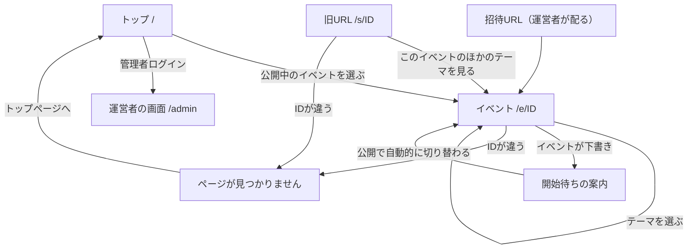
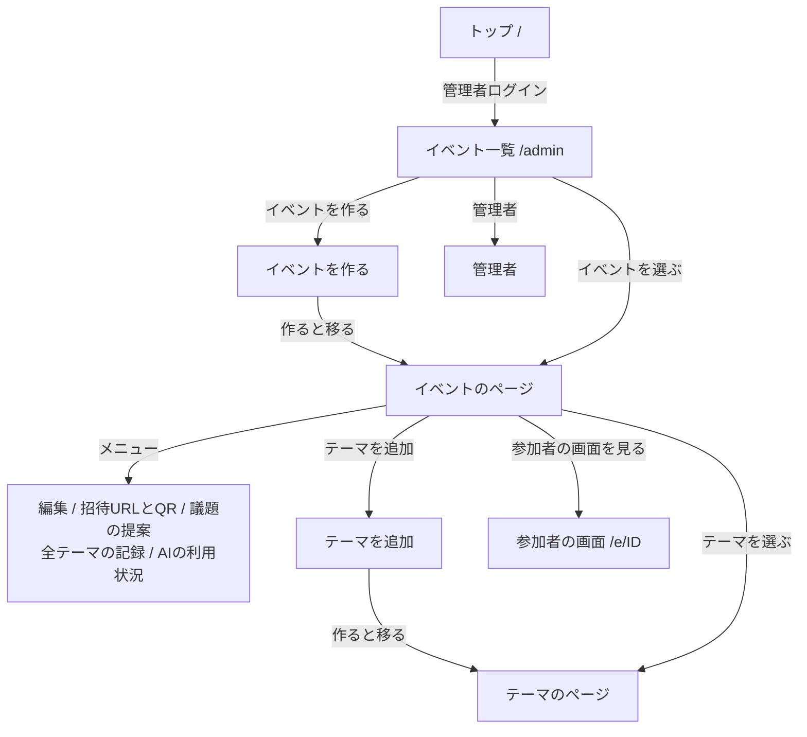
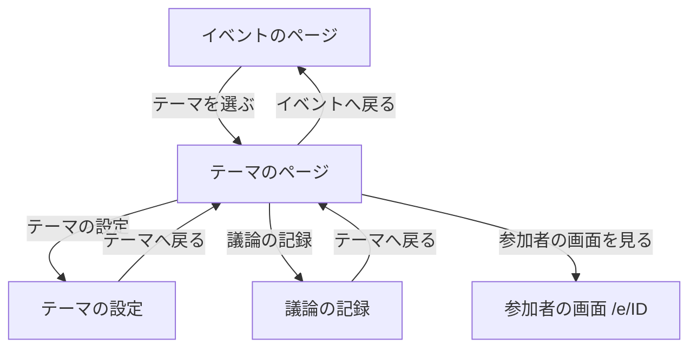

# 画面遷移

画面の一覧と、画面どうしの行き来を示す。新しい画面を足すときは、この文書も更新する。

## 方針

- 1つの画面は、1つの目的に絞る。複数の目的は、別の画面に分ける。
- どの画面からも、1つ上の画面へ戻れる。行き止まりを作らない。
- 管理画面の入口は、管理者のトークンと、Googleのログインだけである。管理者は、すべてのイベントを操作できる。
- 参加者には、招待URL（`/e/<イベントID>`）だけを配る。テーマごとのURLのコピーとQRは、出さない。
- 画面の中身は「テーマ」と呼ぶ。コードの名前（`session`）とは、分けて考える。

## 画面一覧

### 参加者

| URL | 目的 |
| --- | --- |
| `/` | トップページ。公開中のイベントの一覧（招待なしで入れる）、サンプルのボード、管理者ログインへのリンク。 |
| `/e/<イベントID>` | 招待URL。テーマの一覧、ボード（基本の画面）、議題の提案、公開された記録。 |
| `/e/<イベントID>#post` | 投稿画面。ボードの「投稿する」リンクから開く。投稿すると、ボードへ戻る。 |
| `/s/<テーマID>` | 旧URL。ひとつのテーマの投稿と閲覧。イベントのページへのリンクがある。 |

### 運営者（入口とイベント）

| URL | 目的 |
| --- | --- |
| `/admin` | イベント一覧。作成と管理者へのリンク。 |
| `/admin/events/new` | イベントを作る。作ると、そのイベントのページへ移る。 |
| `/admin/admins` | 管理者の追加と削除。オーナーだけ。 |
| `/admin/events/<ID>` | イベントの名前、状態、説明。テーマの切り替えと一覧。操作のメニュー。 |
| `/admin/events/<ID>/edit` | 名前、説明、状態の編集。 |
| `/admin/events/<ID>/invite` | 招待URLのコピーとQR。 |
| `/admin/events/<ID>/proposals` | 議題の提案の受け付けと、承認・却下・統合。 |
| `/admin/events/<ID>/notes` | 全テーマの議論の記録。 |
| `/admin/events/<ID>/usage` | AIの今日の利用状況。 |
| `/admin/events/<ID>/sessions/new` | テーマを追加する。作ると、そのテーマのページへ移る。 |

### 運営者（テーマ）

| URL | 目的 |
| --- | --- |
| `/admin/events/<ID>/sessions/<テーマID>` | ボード（基本の画面）、AIの分析、テーマのメニュー。 |
| `.../sessions/<テーマID>#manage` | 意見の管理画面。一覧で、非表示と削除。「ボードへ戻る」で戻る。 |
| `.../sessions/<テーマID>/edit` | 名前、問い、形式、状態、意見を見せるかの設定。 |
| `.../sessions/<テーマID>/notes` | 議論の記録の編集と公開。 |

## 参加者の遷移

mermaidのソース

- 参加者は、ログインなしで使う。
- 公開中（active）のイベントは、招待URLがなくても、トップページの一覧から入れる。下書きと終了は、一覧に出ない。
- 不審な投稿が続くときは、運営者が、イベントのページで「すべて閉じる」を選ぶ。投稿はできなくなり、閲覧はできる。
- イベントの画面は、30秒ごとに自動で更新する。運営者がテーマを開閉すると、追従する。

## 運営者の遷移（入口とイベント）

mermaidのソース

- 下位の画面は、すべて「イベント」へ戻るリンクを持つ。

## 運営者の遷移（テーマ）

mermaidのソース

- テーマが下書きのときは、警告に「テーマの設定を開く」を添える。公開中にすると、参加者に見える。
- 共通の枠（アカウントのアイコン、トップページへのリンク）は、すべての管理画面にある。アイコンから、ログアウトできる。

## 共通の枠（管理画面）

- 右上のアカウントのアイコンをタップすると、ログイン中のアカウントと、ログアウトが出る。
- 戻るリンクは、1つ上の画面へ移る。
- 「トップページ」のボタンは、すべての管理画面に出る。

## 改善の記録（#153）

| 問題 | 対応 |
| --- | --- |
| 一覧に、作成フォームと管理者の欄が同居していた。 | 別の画面にし、一覧にはリンクだけを置いた。 |
| イベントのページに、利用状況、記録、提案が同居していた。 | 別の画面にし、メニューから開くようにした。 |
| テーマのページに、設定と記録の編集が同居していた。 | 別の画面にし、意見と分析に絞った。 |
| イベントを作っても、続きの設定へ進めなかった。 | 作ると、イベントのページへ移るようにした。 |
| 旧URLから、ほかのテーマへ行けなかった。 | イベントのページへのリンクを出した。 |
| 見つからないページが、行き止まりだった。 | トップページへのリンクを置いた。 |
| 管理画面から、参加者の画面を確かめられなかった。 | 「参加者の画面を見る」を置いた。 |

## 新しい画面を足すとき

- 目的が1つに絞れているか確かめる。
- 1つ上の画面へ戻るリンクがあるか確かめる。
- 権限によって、見せない入口があるか確かめる。
- この文書の一覧と図を更新する。図を足したら、`mermaid_doc_paths`（`.github/workflows/ci.yml`）の登録と、画像の埋め込みを確かめる。
